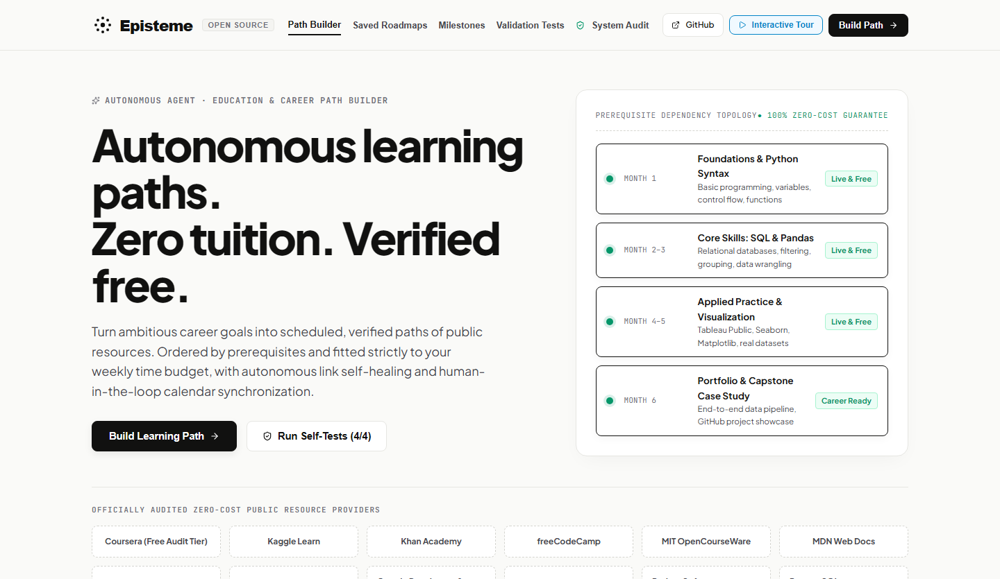

<div align="center">

```
╔══════════════════════════════════════════════════════════════════════════════╗
║                                                                              ║
║    ███████╗██████╗ ██╗███████╗████████╗███████╗███╗   ███╗███████╗           ║
║    ██╔════╝██╔══██╗██║██╔════╝╚══██╔══╝██╔════╝████╗ ████║██╔════╝           ║
║    █████╗  ██████╔╝██║███████╗   ██║   █████╗  ██╔████╔██║█████╗             ║
║    ██╔══╝  ██╔═══╝ ██║╚════██║   ██║   ██╔══╝  ██║╚██╔╝██║██╔══╝             ║
║    ███████╗██║     ██║███████║   ██║   ███████╗██║ ╚═╝ ██║███████╗           ║
║    ╚══════╝╚═╝     ╚═╝╚══════╝   ╚═╝   ╚══════╝╚═╝     ╚═╝╚══════╝           ║
║                                                                              ║
║          AI  ·  Autonomous Self-Healing Learning Path Engine                 ║
║                                                                              ║
║    ἐπιστήμη  —  justified, verified truth  •  not mere opinion (δόξα)        ║
║                                                                              ║
╚══════════════════════════════════════════════════════════════════════════════╝
```

**Live Demo (no login required):** [episteme-ai-one.vercel.app](https://episteme-ai-one.vercel.app)

</div>

# Episteme AI — Autonomous Self-Healing Learning Path Engine

[](https://episteme-ai-one.vercel.app)
[](https://github.com/SreeNaresh1/episteme-ai/actions/workflows/ci.yml)
[](https://nextjs.org/)
[](https://react.dev/)
[](https://www.typescriptlang.org/)
[](https://cheerio.js.org/)
[](https://aistudio.google.com/)
[](https://sqlite.org/)
[](#-core-validation-scenarios--verification-evidence)
[](#-automated-verification--audit-suite)
[](#-system-architecture)
[](LICENSE)
[](CONTRIBUTING.md)

> **Episteme** (Ancient Greek: *ἐπιστήμη* — justified, verified truth vs. *δόξα* / unverified opinion) turns career goals into strictly time-bounded, prerequisite-ordered weekly roadmaps built exclusively from **free public courseware**, backed by **Cheerio DOM paywall & dead-link detection**, **curated self-healing swaps**, and **approval-gated calendar & audit-link dispatch**.



---

## 🛠️ Try the Paywall & Free-Course Verifier (CLI / API)

Want to test the Cheerio DOM + Schema.org `isAccessibleForFree` detector on any course URL in 5 seconds without booting the full app?

```bash
# CLI (runs directly via Node + Cheerio)
npm run check-url -- https://docs.python.org/3/tutorial/
npm run check-url -- https://example.com --json

# Or query the live API
curl "https://episteme-ai-one.vercel.app/api/verify-url?url=https://docs.python.org/3/tutorial/"
```

---

## ⚡ Core Engineering Guarantees

| Capability | Implementation | Code Location |
| :--- | :--- | :--- |
| **Strict Hours Budget** | Validates Gemini JSON output against exact week counts, per-week hour caps, total hour sums, and an approved free-URL allowlist, with a deterministic 52-week fallback if validation fails or no API key is configured. | [`pathGenerator.ts`](src/lib/pathGenerator.ts) |
| **Paywall & 404 Detection** | Checks URL reachability using browser headers and `AbortController` timeouts, inspects JSON-LD `isAccessibleForFree` / zero-price `offers`, and scores paywall regexes against free-audit markers via Cheerio. | [`linkChecker.ts`](src/lib/linkChecker.ts), [`webDiscovery.ts`](src/lib/webDiscovery.ts) |
| **Self-Healing Replacements** | Matches topic-tagged candidates from the curated free-courseware index (`REPLACEMENT_POOL`), live-crawls the top match with Cheerio, and persists replacement reasons in SQLite. | [`webDiscovery.ts`](src/lib/webDiscovery.ts) |
| **Approval Gate & Idempotency** | Keeps proposed enrollments and calendar blocks in `pending_approval` behind a SQLite `UNIQUE(idempotency_key)` constraint so retries never duplicate events. | [`db.ts`](src/lib/db.ts), [`platformEnrollment.ts`](src/lib/platformEnrollment.ts) |
| **Calendar & Deep-Link Dispatch** | Generates Coursera Free Audit deep links (`?action=enroll&courseAudit=true`), Google Calendar intent URLs, and RFC-5545 `.ics` exports alongside local tracking records. | [`platformEnrollment.ts`](src/lib/platformEnrollment.ts), [`calendarExport.ts`](src/lib/calendarExport.ts) |
| **Milestones & Progress Tracking** | Tracks weekly deliverables and competency rubrics across phases, generating a completion certificate with a deterministic hex reference ID. | [`learningOutcomes.ts`](src/lib/learningOutcomes.ts) |

---

## 🌟 Why Episteme?

Most AI study planners suffer from three recurring failure modes:
- Courses labeled "free" that hit a credit-card paywall mid-curriculum.
- Hallucinated or dead 404 links.
- Unbounded workloads that ignore real-world weekly availability.

**Episteme AI addresses these at the pipeline level**:
1. **Constrained Planning**: Every generated roadmap satisfies exact weekly capacity (e.g., 5h/week for 26 weeks = 130h) and restricts LLM URL selection to an approved free-resource pool.
2. **DOM-Level Verification**: Instead of trusting HTTP `200 OK` alone, Cheerio strips layout noise and inspects Schema.org metadata plus paywall signals before a link stays in a plan.
3. **Human-in-the-Loop Gatekeeper**: External actions wait in `pending_approval` until explicitly approved by the user.
4. **Idempotent Persistence**: SQLite transactions and unique idempotency keys prevent duplicate calendar dispatches across reruns.

---

## 📐 System Architecture

Episteme AI operates as a multi-phase pipeline:

```
┌────────────────────────────────────────────────────────────────────────┐
│                        EPISTEME AGENTIC ENGINE                         │
└────────────────────────────────────────────────────────────────────────┘
                                    │
    1. INTAKE & CONSTRAINTS         ▼
    ┌────────────────────────────────────────────────────────────────────┐
    │ Goal: "Become a Data Analyst" | Level: Beginner                    │
    │ Time Constraints: 5h / week × 26 weeks = 130 Total Hours Budget    │
    └────────────────────────────────────────────────────────────────────┘
                                    │
    2. REASONING & PREREQUISITE DAG ▼
    ┌────────────────────────────────────────────────────────────────────┐
    │ Gemini 2.0 Flash (allowlist-constrained) + 52-week fallback mapper │
    │ Orders topics: Foundations → Relational SQL → Python → Capstone    │
    │ Validates exact week count, hours cap, and approved URLs           │
    └────────────────────────────────────────────────────────────────────┘
                                    │
    3. LINK VERIFICATION & DOM INSPECTION
    ┌────────────────────────────────────────────────────────────────────┐
    │ Resilient HTTP Fetcher & Cheerio DOM Inspector                     │
    │ • Checks HTTP reachability with AbortController timeout SLAs       │
    │ • Evaluates paywall signatures vs. free-audit markers              │
    │ • Validates Schema.org isAccessibleForFree / offers.price JSON-LD  │
    └────────────────────────────────────────────────────────────────────┘
                                    │
                                    ├─── [Broken Link or Paywall Found?]
                                    │               │
                                    │               ▼ (SELF-HEALING SWAP)
                                    │   ┌────────────────────────────────┐
                                    │   │ Topic-Matched Courseware Index │
                                    │   │ Live Cheerio DOM Verification  │
                                    │   │ Hot-Swap in DB & Store Reason  │
                                    │   └────────────────────────────────┘
                                    ▼
    4. HUMAN APPROVAL GATEWAY (HITL)
    ┌────────────────────────────────────────────────────────────────────┐
    │ Displays proposed actions, exact resource URLs, and hours          │
    │ Requires explicit user approval before enrollment/calendar dispatch│
    └────────────────────────────────────────────────────────────────────┘
                                    │
    5. DEEP-LINK DISPATCH & CALENDAR SYNC ▼
    ┌────────────────────────────────────────────────────────────────────┐
    │ • Coursera Free Audit (?action=enroll&courseAudit=true) & Kaggle   │
    │ • 1-Click Google Calendar event template URLs                      │
    │ • RFC-5545 standard .ics calendar export                           │
    │ • SQLite tracking with UNIQUE idempotency_key guard                │
    └────────────────────────────────────────────────────────────────────┘
                                    │
    6. OUTCOMES & PROGRESS TRACKING ▼
    ┌────────────────────────────────────────────────────────────────────┐
    │ • Weekly milestone deliverables & competency rubrics               │
    │ • Completion certificate with deterministic hex reference ID       │
    └────────────────────────────────────────────────────────────────────┘
```

---

## 🧪 Core Validation Scenarios & Verification Evidence

Episteme AI includes an automated test suite (`/api/testcases`) executing 4 core validation scenarios against SQLite transactions:

| Scenario ID | Test Scenario | Specification & Expected Behavior | Automated Output Summary | Status |
| :--- | :--- | :--- | :--- | :---: |
| **TC1** | **6 Months at 5 h/week** | Curriculum must fit exact 26-week horizon at 5 h/week (130h total budget) with valid free resources. | `Weeks generated: 26/26. Total hours: 130/130 (exact match). Per-week limit (≤5h) respected: true.` | **PASSED** |
| **TC2** | **Course Becomes Paid** | Detect paywalled course URLs (e.g. Udemy/Pluralsight), flag status, and swap with verified free alternative. | `Paid course detected: true (status=paid). Replacement proposed & verified live_free: freeCodeCamp Data Analysis with Python.` | **PASSED** |
| **TC3** | **Broken Link / 404** | Detect unreachable URL, match replacement from free courseware index, verify live status, hot-swap plan. | `Broken link detected: true (status=broken). Replacement verified (status=live_free). Replaced in plan.` | **PASSED** |
| **TC4** | **Rerun / Idempotency** | On rerun, append only missing sessions and prevent duplicate calendar actions via `idempotency_key`. | `Total weeks: 4. Completed: 2. Missing added: 2. Duplicate prevented: true.` | **PASSED** |

---

## 🛡️ Automated Verification & Audit Suite

Run the 7-check verification suite from the CLI or the dashboard UI:

```bash
npm run test:organizer
```

| Check ID | Check Name | Specification | Status |
| :--- | :--- | :--- | :---: |
| `AUDIT-CRAWLER-01` | **HTTP Header Resilience** | Sends browser `User-Agent` and `Sec-Ch-Ua` headers during reachability checks | **PASSED** |
| `AUDIT-CRAWLER-02` | **Crawler Timeout SLA** | `AbortController` aborts stalled requests within configured SLA | **PASSED** |
| `AUDIT-DOM-03` | **Cheerio DOM Paywalls** | Parses Schema.org JSON-LD and scores paywall vs. free-audit text markers | **PASSED** |
| `AUDIT-DAG-04` | **Prerequisite Ordering** | Verifies sequential topology from foundations to capstone with zero duplicate modules | **PASSED** |
| `AUDIT-DISCOVERY-05` | **Fallback Discovery** | Matches topic-tagged alternatives and verifies free status via Cheerio | **PASSED** |
| `AUDIT-ENROLL-06` | **Audit Deep Links & Sync** | Builds Coursera `courseAudit=true` deep links and Google Calendar intent URLs | **PASSED** |
| `AUDIT-ACID-07` | **SQLite Idempotency** | Enforces `UNIQUE(idempotency_key)` constraint against duplicate dispatch | **PASSED** |

---

## 🛠️ Technology Stack

| Layer | Technology | Role |
| :--- | :--- | :--- |
| **Framework** | Next.js 16.4.2 (App Router & Turbopack) | Server-rendered API routes, reactive dashboard, and interactive slide deck |
| **UI & Styling** | React 19, Tailwind CSS v4 + CSS Variables, Lucide Icons | Editorial design system, responsive tables, and interactive tour |
| **AI Reasoning** | Google Gemini 2.0 Flash (`@google/generative-ai`) | Allowlist-constrained curriculum ordering (falls back cleanly when unset) |
| **Persistence** | SQLite via `better-sqlite3` (WAL locally, `/tmp` on Vercel) | Stateful runs, weeks, resources, approval actions, and idempotency keys |
| **DOM Inspection** | Cheerio v1.2.0 | Server-side HTML parsing for Schema.org JSON-LD & paywall heuristics |
| **Scheduling** | Google Calendar Intent URLs & RFC-5545 `.ics` | 1-click event links plus universal iCalendar export |

---

## 🚀 Getting Started

### 1. Prerequisites
- Node.js 18.18+ or 20+
- npm (note: `better-sqlite3` compiles a native addon if prebuilds aren't available for your OS/Node version)

### 2. Installation
```bash
# Clone the repository
git clone https://github.com/SreeNaresh1/episteme-ai.git
cd episteme-ai

# Install dependencies
npm install

# Optional: add GEMINI_API_KEY in .env.local for LLM generation
# (Without a key, Episteme AI uses its deterministic 52-week curriculum builder)
```

### 3. Running the Development Server
```bash
npm run dev
```
Open [http://localhost:3000](http://localhost:3000) in your browser.

### 4. Running the Verification Suites
Trigger the suites from the UI or via CLI:
```bash
# Core Validation Scenarios (TC1-TC4)
curl -X POST http://localhost:3000/api/testcases

# Automated Verification Suite (7/7)
curl -X POST http://localhost:3000/api/organizer-audit

# CLI Runner
npm run test:organizer
```

---

## 📁 Repository Directory Structure

```
episteme-ai/
├── .github/
│   ├── ISSUE_TEMPLATE/
│   │   ├── bug_report.md
│   │   └── feature_request.md
│   ├── workflows/
│   │   └── ci.yml                      # TypeScript, Cheerio self-test & Next.js build CI
│   └── PULL_REQUEST_TEMPLATE.md
├── data/
│   └── organizer_audit_log.json        # Audit suite execution log
├── docs/
│   ├── Episteme_AI_Presentation.pptx   # Architecture presentation deck
│   └── ORGANIZER_VALIDATION.md         # Validation manifest
├── public/                             # Static assets, icons, screenshots & SVG
├── scripts/
│   ├── check-url.mjs                   # Standalone CLI paywall & Schema.org inspector
│   ├── concept_document.html           # Printable concept document source
│   ├── generate-icons.js
│   └── organizer-cli.js                # CLI runner for the 7-check audit suite
├── src/
│   ├── app/
│   │   ├── api/
│   │   │   ├── health/                 # System health probe
│   │   │   ├── organizer-audit/        # 7-check verification suite endpoint
│   │   │   ├── runs/                   # Create and list learning path runs
│   │   │   │   └── [id]/
│   │   │   │       ├── approve/        # HITL gate & deep-link/calendar dispatch
│   │   │   │       ├── inject-demo/    # Demo broken/paid URL injection for testing
│   │   │   │       ├── progress/       # Milestones & completion tracking
│   │   │   │       └── verify/         # Live re-check & self-healing swap
│   │   │   ├── testcases/              # Core validation suite (TC1-TC4)
│   │   │   └── verify-url/             # Public URL & Cheerio DOM paywall API
│   │   ├── presentation/               # Interactive presentation slide deck
│   │   ├── globals.css                 # Tailwind v4 + editorial CSS variables
│   │   ├── layout.tsx                  # Metadata & font loading
│   │   └── page.tsx                    # Dashboard & interactive walkthrough
│   └── lib/
│       ├── curricula/                  # Curated 52-week domain curricula
│       ├── calendarExport.ts           # RFC-5545 iCalendar (.ics) generator
│       ├── db.ts                       # SQLite schema & WAL/serverless setup
│       ├── learningOutcomes.ts         # Milestones, rubrics & completion cert
│       ├── linkChecker.ts              # Paid/free patterns & HTTP link checker
│       ├── organizerAudit.ts           # 7-check audit runner
│       ├── pathGenerator.ts            # Gemini prompt, validator & fallback
│       ├── paywallInspector.mjs        # Shared Cheerio DOM & JSON-LD paywall inspector
│       ├── platformEnrollment.ts       # Audit deep links & GCal URL builder
│       └── webDiscovery.ts             # Topic-matched replacement & DOM verification
├── ACCESSIBILITY.md
├── CODE_OF_CONDUCT.md
├── CONTRIBUTING.md
├── DEPLOYMENT.md
├── Dockerfile
├── LICENSE
├── SECURITY.md
├── docker-compose.yml
├── next.config.ts
├── package.json
└── tsconfig.json
```

---

## 🤝 Contributing & Community

Episteme AI welcomes contributions of all kinds — bug reports, paywall heuristic improvements, new free curricula, documentation updates, and PRs.

- 📖 Read the [Contributing Guide](CONTRIBUTING.md) to get started
- 🐛 [Report a Bug](.github/ISSUE_TEMPLATE/bug_report.md) | ✨ [Request a Feature](.github/ISSUE_TEMPLATE/feature_request.md)
- 💬 [Start a Discussion](https://github.com/SreeNaresh1/episteme-ai/discussions)
- 🛡️ [Security Policy](SECURITY.md) | ♿ [Accessibility Statement](ACCESSIBILITY.md)
- ⭐ **If Episteme AI helped you, please star the repo** — it helps others discover it!

---

## 🛡️ License & Fair Use

Code in this repository is licensed under the [MIT License](LICENSE).

All external course syllabi, documentation, tutorials, and trademarked names (Coursera®, Kaggle®, Khan Academy®, freeCodeCamp®, MIT OpenCourseWare®, Harvard CS50®, MDN Web Docs®) belong to their respective institutions. **Episteme AI** acts as an open-access aggregator and scheduler verifying zero-cost auditability under educational fair-use guidance.
